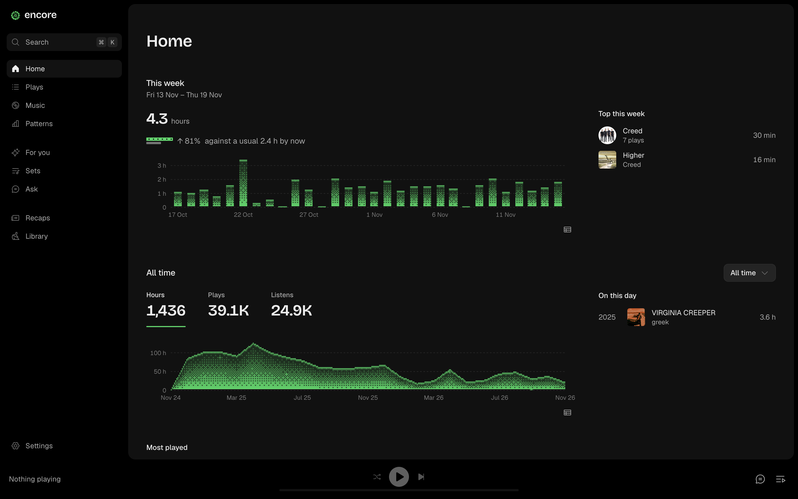
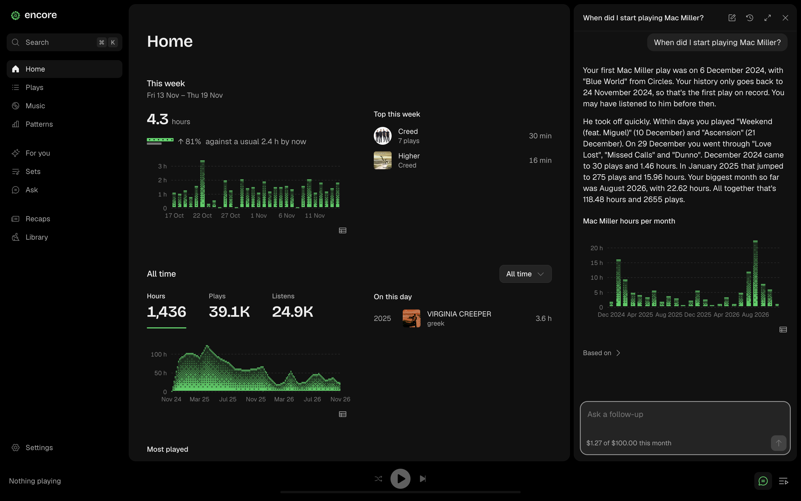
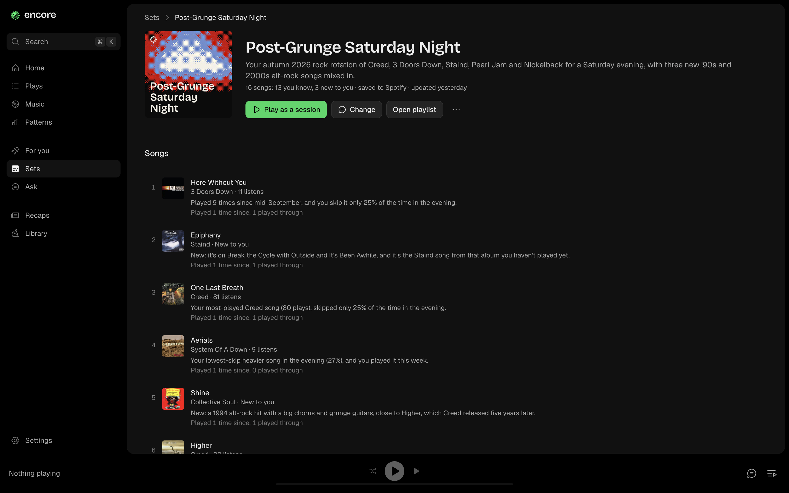
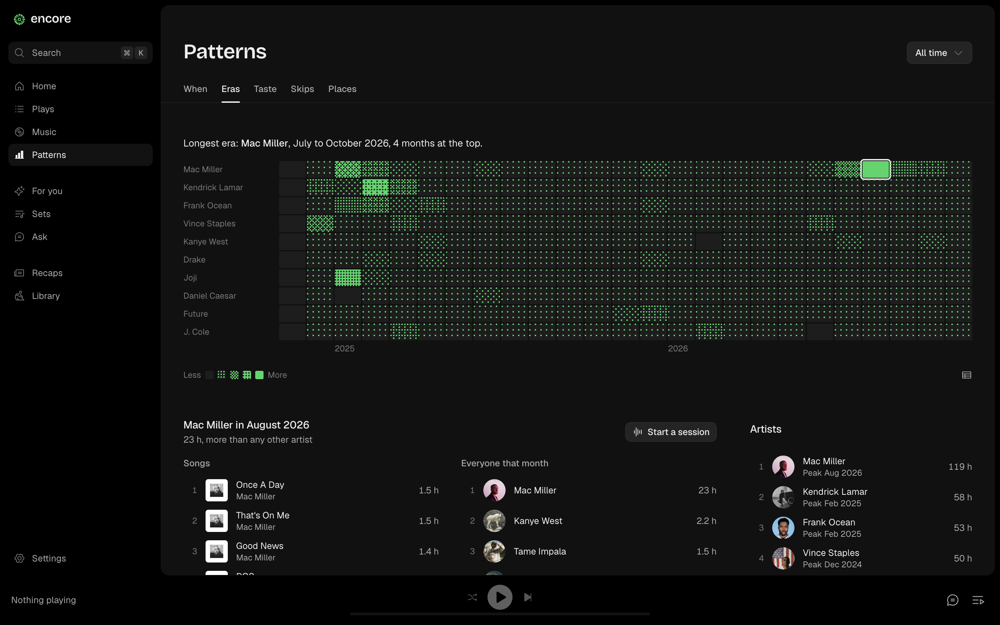
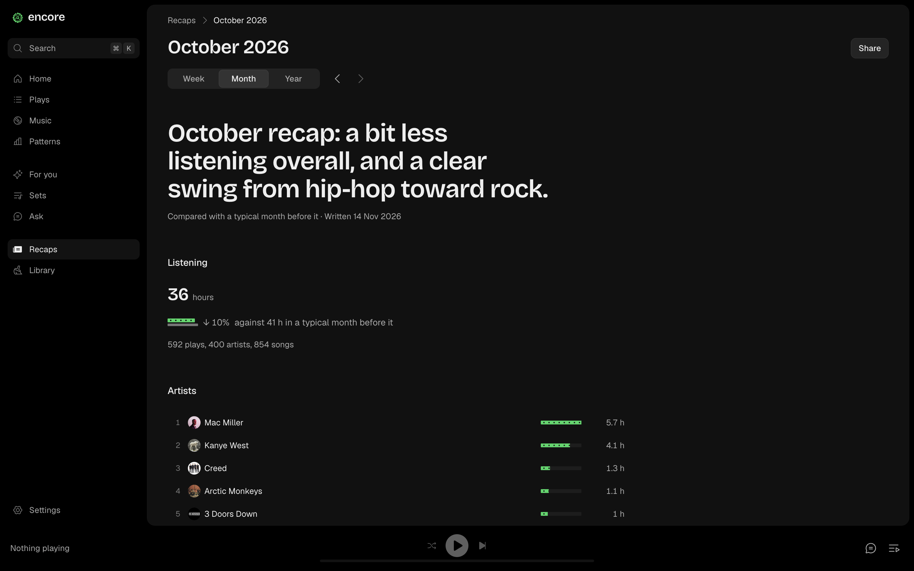
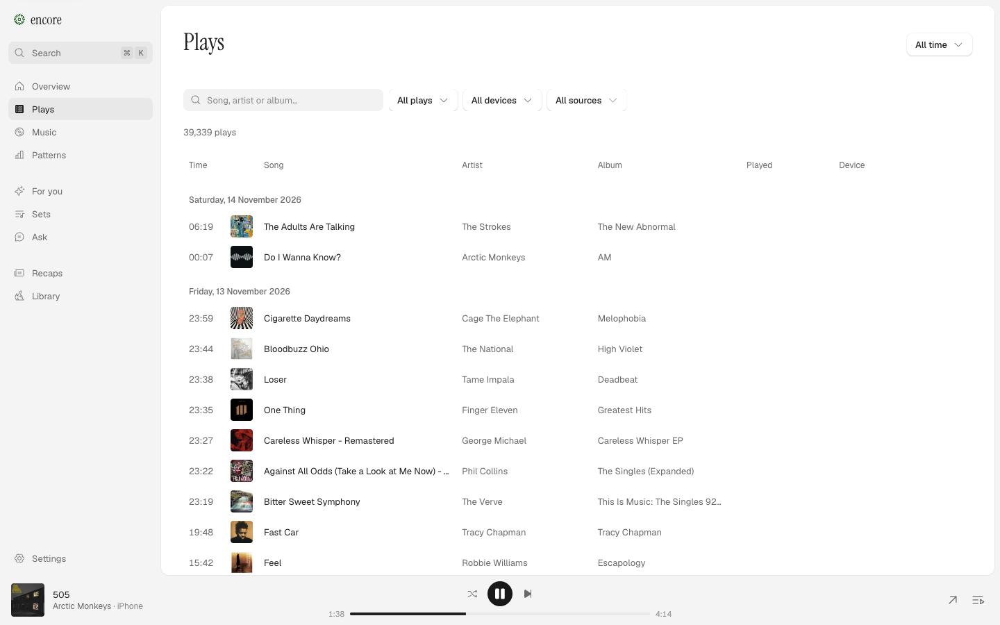

# encore

A self-hosted dashboard for your own Spotify listening. It imports your full streaming history, keeps logging new plays, and shows what you listen to, when, and how that changes. With an AI provider (Anthropic, OpenAI, Google, or any OpenAI-compatible server such as OpenRouter or a local Ollama) it also builds playlists from a prompt, picks new songs each week, and answers questions about your history.

One instance serves one person. Your data stays in a single SQLite file on your server.



## What it does

**Listening**

- **Home**: this week against your usual, then time listened, plays and listens for any range, with top artists, songs and albums; below them, what encore made for you and your latest recap.
- **Plays**: the full log, searchable and filterable by device and source.
- **Music**: every artist, album and song you have played, each with its own page, plus favourites you stopped playing and the podcasts you listen to.
- **Patterns**: when in the week you listen, which artists defined which months, genres, moods and release decades over time, the music you find each month and the artists you come back to, your records and milestones, how plays end and when you skip, and trips and devices.

**Play** (needs an AI provider)

- **Sets**: describe a playlist and it is built from your history plus songs you have never played, with a reason for each. Refine it by chat, save it to Spotify, or play it as a session that adapts as you skip.
- **Weekly picks**: a few new songs picked each week, each with its reason, at the head of Playlists.
- **Chat**: a side panel on every page that knows what you are looking at. Ask about your listening, make a set, or plan a library cleanup; answers come from your history, with charts where they help.

**Playlists**

- One list of every playlist encore makes, each on the same page: how it fills, its songs, its changes, Play.
- Private playlists encore keeps refilling: Weekly picks, Forgotten favourites, Most played lately, New from your artists, This month in past years, This year so far (which becomes that year's playlist when the year ends), and Right now (what you play at this hour on this weekday). Each can be seen and played in encore; Keep in Spotify adds it to your account; Freeze keeps its songs until you refresh it. Only Weekly picks needs an AI provider.
- Build from rules: your own playlist from a rule (where the songs come from, filters on listens, dates, artists and release years, order, size, songs per artist, refresh), with a live preview. Sets and the playlists saved from recaps sit in the same list.

**Upkeep**

- **Recaps**: each week, month and year as a page of what changed: totals against the period before, artists up and down, genre and mood shifts, new songs that stuck, the busiest day and hour, with small inline charts. With AI set up, each recap gets a headline and one line per section; without it the page shows the numbers alone. Each recap has its playlist, the songs that defined the period, playable from the page and saved to Spotify with a cover titled with the period when you tap Save. A share card (wide or square) downloads from the page and goes with recaps posted to Discord, and a public link shows a frozen, read-only copy of one recap to anyone you give it to: made only when you ask, revocable, optionally expiring (see [docs/sharing.md](docs/sharing.md)).
- **Library**: how much of your liked songs and playlists you still play, and where the dead weight sits. Plans to tidy them, ready-made, from a group of songs, or by saying what you want ("clean up what I don't listen to anymore") and talking it through; a standing instruction can make one on a schedule: archive (the default) or remove, keep one copy of duplicates, like what you play a lot. Nothing changes in Spotify until you approve a plan, and every applied plan can be undone.

| | |
| --- | --- |
|  |  |
|  |  |
|  |  |

Optional integrations: Discord commands and channel posts, and an MCP server over your analytics and playback.

## What you need

- A Spotify account. Playback control needs Spotify Premium.
- Your extended streaming history: request it in your Spotify account under Privacy settings, "Extended streaming history". Spotify sends it within about 30 days. encore works without it, but then starts from the day you connect.
- A Spotify app from [developer.spotify.com/dashboard](https://developer.spotify.com/dashboard): Web API, development mode. No client secret is used.
- Optional: an AI provider for Sets, picks, Ask, liner notes and recap lines: an API key from Anthropic, OpenAI or Google, or the address of an OpenAI-compatible server (OpenRouter, Groq, Mistral, Ollama, LM Studio). Weekly picks cite web sources only with a provider that has web search (Anthropic, OpenAI, Google). A monthly spend cap applies (default 100 USD, change it in Settings › AI).

Spotify limits development-mode apps: some endpoints have a daily quota per Spotify account. When Spotify answers `QUOTA_EXCEEDED`, encore pauses only that endpoint until the time Spotify gives, and fills in the missing track and artist details later.

## Run it

### Docker

```sh
git clone https://github.com/mshll/encore.git && cd encore
export SETUP_TOKEN=$(openssl rand -hex 24)
export SECRETS_KEY=$(openssl rand -hex 32)
echo "Setup token: $SETUP_TOKEN"
docker compose -f docker-compose.yml -f docker-compose.local.yml up --build
```

Open `http://localhost:8888`. Use `localhost`, not `127.0.0.1`: passkeys need a domain name.

Keep `SECRETS_KEY`. It encrypts the keys and tokens you save in Settings; if it changes, they must be entered again.

### On a server

`docker-compose.yml` builds one image and keeps the database in the named volume `encore-data` (mounted at `/data`). It exposes port 3000 without publishing it; put a reverse proxy with HTTPS in front (for example a Dokploy domain on service `encore`, port 3000).

Set three environment variables:

| Variable | Value |
| --- | --- |
| `PUBLIC_BASE_URL` | The address you open in the browser, such as `https://encore.example.com` |
| `SETUP_TOKEN` | At least 24 characters. Needed once, to create the first passkey |
| `SECRETS_KEY` | At least 32 characters. Encrypts secrets saved from the dashboard |

Everything else is set in the dashboard. Do not delete or rename the `encore-data` volume: track and artist details in it take days of Spotify quota to fetch again.

### First run

The app walks you through setup:

1. Enter the setup token and create a passkey. After that, sign-in is by passkey only.
2. Paste your Spotify app's client id. Setup shows the redirect URI to register in the Spotify app (`PUBLIC_BASE_URL/callback`; locally `http://127.0.0.1:8888/callback`).
3. Connect Spotify.
4. Choose your time zone, home country and weekend days. Do this before the import: the time zone applies only to plays stored after it is set.
5. Upload the `Streaming_History_Audio_*.json` and `Streaming_History_Video_*.json` files from the export. Importing again is safe; rows already stored are skipped.
6. Optional: set up an AI provider, Discord and an MCP token.

## Connect Claude (MCP)

encore serves an MCP server at `/mcp` with tools over your listening (overview, top lists, history, lookup, on this day, forgotten favourites, discovery, comebacks, loyalty, records, decades, year against year, listening calendar, listening sessions, how plays start, variety, seasonal favourites, staying power, what encore found, obsessions, podcasts, now playing, releases, devices), playback actions (play, add to queue, pause, resume, skip next, skip previous), and three changes: create a playlist, add tracks to a playlist (including the songs `forgotten` returns), and mark releases as seen. The full list with inputs is in [docs/api.md](docs/api.md#mcp).

**claude.ai, Claude Desktop and mobile** (one connector serves all three):

1. In encore, Settings › Integrations › MCP: switch on OAuth sign-in and save.
2. In Claude, Settings › Connectors › Add custom connector. Name it `encore` and enter `https://<your host>/mcp` as the URL. Leave the OAuth client fields empty.
3. Claude opens encore: sign in with your passkey if asked, check the app and the tools it gets, and choose Allow.

Claude connects from Anthropic's servers, so encore must be reachable from the public internet over HTTPS on port 443. Disconnect a client in Settings › Integrations › MCP; it then has to sign in again.

**Claude Code and other clients that can send a header**: set an MCP token in the same place, then for example

```sh
claude mcp add --transport http encore https://<your host>/mcp --header "Authorization: Bearer <MCP token>"
```

Claude Code can also use OAuth sign-in: add the server without the header and run `/mcp` to sign in.

## Configuration

Settings live in the database and are edited in the dashboard; a change applies without a restart. Only boot values (address, port, database path, the three variables above) come from the environment. An environment variable with a setting's name overrides the dashboard and locks that field, which is useful for managed deployments.

The full list, with defaults: [docs/configuration.md](docs/configuration.md). The HTTP API: [docs/api.md](docs/api.md).

## Privacy and safety

- The `ip_addr` field in the Spotify export is never stored.
- Secrets saved from the dashboard are encrypted at rest and never returned by the API.
- encore never starts playback, removes saved songs or edits your playlists without an action from you. It refills only the playlists it made and you switched on, and never deletes one.
- A skip is pressing next before a song's outro; leaving in the outro counts as played through, and going back or choosing another song is no skip. A skip is treated as context (time, device), never as a dislike on its own.

## Development

Stack: Bun, TypeScript, Hono, SQLite (bun:sqlite with Drizzle), passkeys through SimpleWebAuthn. The UI in `web/` is Vite, React, Tailwind, UI SDK and Phosphor icons, with halftone charts drawn by a vendored dither kit.

```sh
bun install
cp .env.example .env          # set SETUP_TOKEN and SECRETS_KEY
bun run dev                   # API, jobs and the built UI on http://localhost:8888
```

For UI work, run the API on another port and let Vite own 8888:

```sh
PORT=8889 bun run dev
cd web && bun install && bun run dev
```

In a dev build, `/dev/kit` shows every UI primitive, and `?fixture=loading|error|empty|new|worst` on any page shows that state.

Checks before a commit: `bun test`, `bun run typecheck`, and `cd web && bun run typecheck && bun run build`.

Other commands: `bun run import <dir>` imports an export folder from the command line, `bun run discord:register` registers the Discord commands, and `bun run db:generate` writes a migration after a schema change.

Design rules, tokens and the sitemap are in [DESIGN.md](DESIGN.md). Product and Spotify rules for contributors and coding agents are in [CLAUDE.md](CLAUDE.md).

## Layout

```
src/config.ts            boot env validation
src/settings/            settings fields, store (env, then table, then default), secret sealing
src/db/                  Drizzle schema, migrations runner (SQL in drizzle/)
src/plays/               shared play model: song key, device enum, local time, inserts
src/ingest/export/       export parsing, import, CLI
src/ingest/live/         recently-played poller, player watcher and its reconciliation, track and artist enrichment, album art
src/player/              typed Spotify playback API
src/dj/                  DJ sessions on an app-owned playlist, deterministic and AI re-planners
src/radar/               release radar
src/living/              living playlists: rules and their engine, built-in kinds, schedule, refresh
src/library/             saved songs and own playlists sync, library analysis, plans and their rules; apply and undo (only reachable from the HTTP route);
                         song catalog, candidate verification, blocks, play outcomes, library tools
src/discord/             interactions endpoint logic, REST client, command registry, built-in and assistant commands, channel posts
src/mcp/                 MCP server (tools over analytics and playback)
src/oauth/               OAuth 2.1 authorization server for /mcp: client registration, PKCE codes, rotating tokens
src/spotify/             OAuth (PKCE, rotating refresh), API client, call pacing queue, rate-limit gate
src/auth/                passkeys, sessions
src/tags/                tag vocabulary, validation, storage
src/analytics/           pure query functions
src/llm/                 AI provider layer (Vercel AI SDK), cost ledger and budget, agent loop, threads
src/taste/               cached taste profile given to the model
src/sets/ src/picks/     set building and weekly picks
src/covers/              playlist cover and share card drawing (Skia via @napi-rs/canvas); its fonts and their licences are in assets/fonts
src/ask/ src/notes/      questions over the history, liner notes
src/digest/              recap periods, facts, pages, written lines, playlists and cards
src/share/               public share links: frozen snapshots, hashed tokens, the public page
src/assistant/           plain entry points for chat integrations
src/jobs/                scheduler and persisted job state
src/http/                Hono app and routes
web/                     UI (Vite + React), built into web/dist; dither-kit charts vendored in web/src/components/dither-kit
```

## License

MIT. See [LICENSE](LICENSE). The bundled cover fonts, Bricolage Grotesque and Noto Sans Arabic, are under the SIL Open Font License 1.1 (`assets/fonts`).

encore is not affiliated with or endorsed by Spotify.
