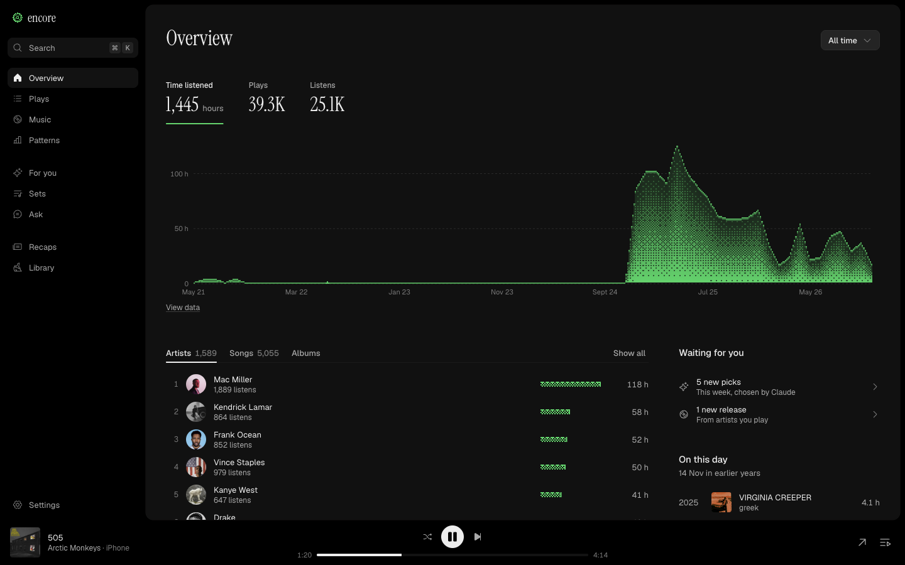
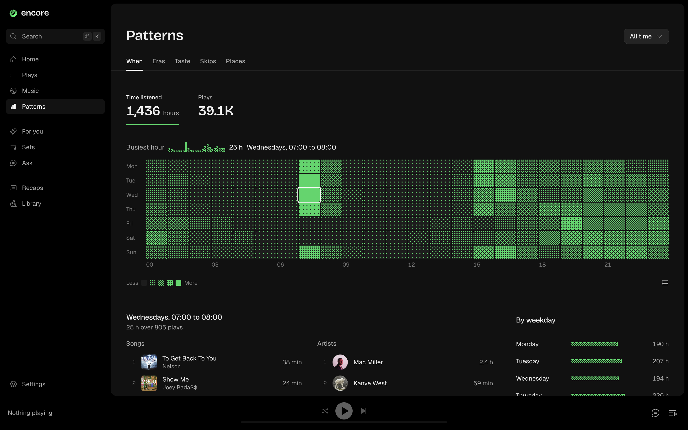

# encore

A self-hosted dashboard for your own Spotify listening. It imports your full streaming history, keeps logging new plays, and shows what you listen to, when, and how that changes. With an Anthropic API key it also builds playlists from a prompt, picks new songs each week, and answers questions about your history.

One instance serves one person. Your data stays in a single SQLite file on your server.



## What it does

**Listening**

- **Overview**: time listened, plays and listens for any range, with top artists, songs and albums.
- **Plays**: the full log, searchable and filterable by device and source.
- **Music**: every artist, album and song you have played, each with its own page, plus favourites you stopped playing.
- **Patterns**: when in the week you listen, which artists defined which months, genres and moods over time, where songs get skipped, and trips and devices.

**Play** (needs an Anthropic API key)

- **Sets**: describe a playlist; Claude builds it from your history plus songs you have never played, with a reason for each. Refine it by chat, save it to Spotify, or play it as a session that adapts as you skip.
- **For you**: a few new songs picked each week, and new releases from artists you play.
- **Ask**: questions about your listening, answered from your history.

**Upkeep**

- **Recaps**: a weekly and a monthly write-up.
- **Library**: how much of your liked songs and playlists you still play, and where the dead weight sits. Plans to tidy them, ready-made, from a group of songs, or by telling Claude what you want ("clean up what I don't listen to anymore") and talking it through; a standing instruction can make one on a schedule: archive (the default) or remove, keep one copy of duplicates, like what you play a lot. Nothing changes in Spotify until you approve a plan, and every applied plan can be undone.

| | |
| --- | --- |
|  |  |
|  |  |

Optional integrations: Discord commands and channel posts, and an MCP server over your analytics and playback.

## What you need

- A Spotify account. Playback control needs Spotify Premium.
- Your extended streaming history: request it in your Spotify account under Privacy settings, "Extended streaming history". Spotify sends it within about 30 days. encore works without it, but then starts from the day you connect.
- A Spotify app from [developer.spotify.com/dashboard](https://developer.spotify.com/dashboard): Web API, development mode. No client secret is used.
- Optional: an [Anthropic API key](https://console.anthropic.com/) for Sets, picks, Ask, liner notes and recaps. A monthly spend cap applies (default 100 USD, change it in Settings).

Spotify limits development-mode apps: some endpoints have a daily quota per Spotify account. When Spotify answers `QUOTA_EXCEEDED`, encore pauses only that endpoint until the time Spotify gives, and fills in the missing track and artist details later.

## Run it

### Docker

```sh
git clone https://github.com/mshll/encore.git && cd encore
export SETUP_TOKEN=$(openssl rand -hex 24)
export SECRETS_KEY=$(openssl rand -hex 32)
echo "Setup token: $SETUP_TOKEN"
docker compose -f docker-compose.yml -f docker-compose.local.yml up --build
```

Open `http://localhost:8888`. Use `localhost`, not `127.0.0.1`: passkeys need a domain name.

Keep `SECRETS_KEY`. It encrypts the keys and tokens you save in Settings; if it changes, they must be entered again.

### On a server

`docker-compose.yml` builds one image and keeps the database in the named volume `encore-data` (mounted at `/data`). It exposes port 3000 without publishing it; put a reverse proxy with HTTPS in front (for example a Dokploy domain on service `encore`, port 3000).

Set three environment variables:

| Variable | Value |
| --- | --- |
| `PUBLIC_BASE_URL` | The address you open in the browser, such as `https://encore.example.com` |
| `SETUP_TOKEN` | At least 24 characters. Needed once, to create the first passkey |
| `SECRETS_KEY` | At least 32 characters. Encrypts secrets saved from the dashboard |

Everything else is set in the dashboard. Do not delete or rename the `encore-data` volume: track and artist details in it take days of Spotify quota to fetch again.

### First run

The app walks you through setup:

1. Enter the setup token and create a passkey. After that, sign-in is by passkey only.
2. Paste your Spotify app's client id. Setup shows the redirect URI to register in the Spotify app (`PUBLIC_BASE_URL/callback`; locally `http://127.0.0.1:8888/callback`).
3. Connect Spotify.
4. Choose your time zone, home country and weekend days. Do this before the import: the time zone applies only to plays stored after it is set.
5. Upload the `Streaming_History_Audio_*.json` and `Streaming_History_Video_*.json` files from the export. Importing again is safe; rows already stored are skipped.
6. Optional: add a Claude key, Discord and an MCP token.

## Configuration

Settings live in the database and are edited in the dashboard; a change applies without a restart. Only boot values (address, port, database path, the three variables above) come from the environment. An environment variable with a setting's name overrides the dashboard and locks that field, which is useful for managed deployments.

The full list, with defaults: [docs/configuration.md](docs/configuration.md). The HTTP API: [docs/api.md](docs/api.md).

## Privacy and safety

- The `ip_addr` field in the Spotify export is never stored.
- Secrets saved from the dashboard are encrypted at rest and never returned by the API.
- encore never starts playback, removes saved songs or edits playlists without an action from you.
- A skipped song is treated as context (time, device, position), never as a dislike on its own.

## Development

Stack: Bun, TypeScript, Hono, SQLite (bun:sqlite with Drizzle), passkeys through SimpleWebAuthn. The UI in `web/` is Vite, React, Tailwind, Base UI and Phosphor icons, with halftone charts drawn by a vendored dither kit.

```sh
bun install
cp .env.example .env          # set SETUP_TOKEN and SECRETS_KEY
bun run dev                   # API, jobs and the built UI on http://localhost:8888
```

For UI work, run the API on another port and let Vite own 8888:

```sh
PORT=8889 bun run dev
cd web && bun install && bun run dev
```

In a dev build, `/dev/kit` shows every UI primitive, and `?fixture=loading|error|empty|new|worst` on any page shows that state.

Checks before a commit: `bun test`, `bun run typecheck`, and `cd web && bun run typecheck && bun run build`.

Other commands: `bun run import <dir>` imports an export folder from the command line, `bun run discord:register` registers the Discord commands, and `bun run db:generate` writes a migration after a schema change.

Design rules, tokens and the sitemap are in [DESIGN.md](DESIGN.md). Product and Spotify rules for contributors and coding agents are in [CLAUDE.md](CLAUDE.md).

## Layout

```
src/config.ts            boot env validation
src/settings/            settings fields, store (env, then table, then default), secret sealing
src/db/                  Drizzle schema, migrations runner (SQL in drizzle/)
src/plays/               shared play model: song key, device enum, local time, inserts
src/ingest/export/       export parsing, import, CLI
src/ingest/live/         recently-played poller, player watcher and its reconciliation, track and artist enrichment, album art
src/player/              typed Spotify playback API
src/dj/                  DJ sessions on an app-owned playlist, deterministic and Claude re-planners
src/radar/               release radar
src/library/             saved songs and own playlists sync, library analysis, plans and their rules; apply and undo (only reachable from the HTTP route);
                         song catalog, candidate verification, blocks, play outcomes, library tools
src/discord/             interactions endpoint logic, REST client, command registry, built-in and assistant commands, channel posts
src/mcp/                 MCP server (tools over analytics and playback)
src/spotify/             OAuth (PKCE, rotating refresh), API client, call pacing queue, rate-limit gate
src/auth/                passkeys, sessions
src/tags/                tag vocabulary, validation, storage
src/analytics/           pure query functions
src/llm/                 Claude client wrapper, cost ledger and budget, agent loop, threads
src/taste/               cached taste profile given to Claude
src/sets/ src/picks/     set building and weekly picks
src/covers/              playlist cover drawing (Skia via @napi-rs/canvas); its fonts and their licences are in assets/fonts
src/ask/ src/notes/      questions over the history, liner notes
src/digest/              weekly and monthly digest facts and text
src/assistant/           plain entry points for chat integrations
src/jobs/                scheduler and persisted job state
src/http/                Hono app and routes
web/                     UI (Vite + React), built into web/dist; dither-kit charts vendored in web/src/components/dither-kit
```

## License

MIT. See [LICENSE](LICENSE). The bundled cover fonts, Bricolage Grotesque and Noto Sans Arabic, are under the SIL Open Font License 1.1 (`assets/fonts`).

encore is not affiliated with or endorsed by Spotify.
